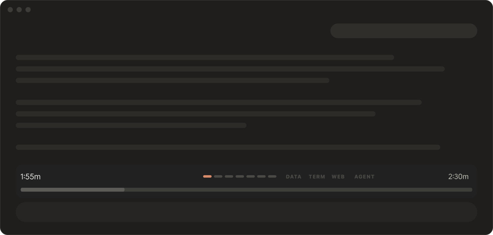
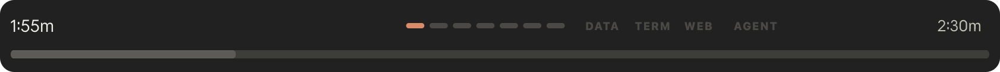
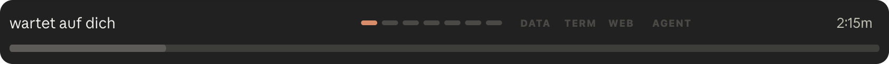
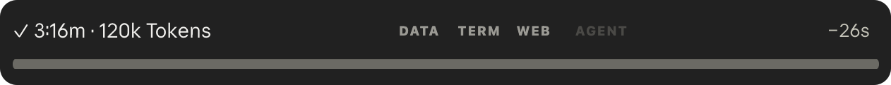
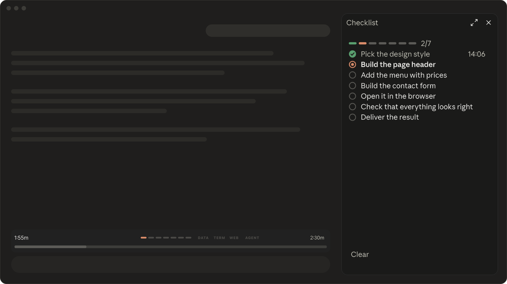

🇬🇧 [English](README.md)

# nix progress-bar

**Wie lange braucht Claude noch? Ein schlanker Balken über dem Eingabefeld sagt es dir.**



## Das Problem

Claude arbeitet, und du weißt nicht: Dauert das zehn Sekunden oder fünf Minuten? Lohnt sich ein Kaffee? Claude Code zeigt nur, *dass* gearbeitet wird – nicht, wie lange noch.

## Die Lösung

Ein schlanker Balken über dem Eingabefeld zeigt die Restzeit und eine Schätzung, die mit jeder Antwort dazulernt. Gestaltet, um sich in Claude einzufügen: Claudes eigene Farben, Dark Mode, keine wilden Farben – clean und minimal.

## Installieren

1. Claude Code öffnen (Desktop-App oder Terminal).
2. Ins Eingabefeld schreiben und Enter drücken:
   ```
   /plugin marketplace add nikscz/nix-progress-bar
   ```
3. Dann:
   ```
   /plugin install nix-progress-bar@nix-progress-bar
   ```
4. Claude Code einmal neu starten (oder `/reload-plugins` eingeben). Fertig.

Kein GitHub-Konto nötig.

## So geht’s

- Links die **Restzeit**, rechts die geschätzte Gesamtdauer – per Klick umschaltbar auf „um 14:32 Uhr“.
- Kleine Labels zeigen, was gerade läuft: **DATA** (Dateien), **TERM** (Terminal), **WEB**, **AGENT**.
- Die Schätzung **lernt mit jeder Antwort** – in beide Richtungen, ohne pauschalen Aufschlag.
- Wartet Claude auf dich (Erlaubnis, Rückfrage), steht dort **„wartet auf dich“** und die Uhr hält an.
- Gespeichert werden nur gelernte Zeiten, in Claude Codes eigenem Plugin-Speicher.
- Folgt deiner Systemsprache (Deutsch oder Englisch) – oder einer Sprache, die du festlegst.

| Befehl | Was passiert |
|---|---|
| `/nix-progress-bar` | blendet den Balken aus und wieder ein |
| `/nix-progress-bar english` / `deutsch` | feste Sprache für den Balken |
| `/nix-progress-bar auto` | folgt wieder der Systemsprache |

### Add-on: nix-checklist-sidebar

Mit [nix-checklist-sidebar](https://github.com/nikscz/nix-checklist-sidebar) dazu zeigt der Balken
Claudes Schritte als **Pills**, und die Schätzung rechnet mit dem Tempo der schon erledigten Schritte
weiter – deutlich genauer. Ohne das Add-on funktioniert der Balken genauso, nur ohne Pills.

## Screenshots

Bei der Arbeit – Restzeit, Schritte als Pills, geschätzte Gesamtdauer:



Claude wartet auf dich – die Uhr steht:



Fertig – Dauer, Tokens und wie weit die Schätzung danebenlag:



Zusammen mit dem Add-on [nix-checklist-sidebar](https://github.com/nikscz/nix-checklist-sidebar):



## Datenschutz & Sicherheit

Alles bleibt auf deinem Rechner:

| Liest | Speichert |
|---|---|
| Länge und Art deiner Nachricht (kurz / mittel / Arbeitsauftrag) | nur diese Einordnung – nie den Text |
| Namen der Werkzeuge, die Claude benutzt; bei Terminal-Befehlen den Befehl, nur um Datei-Änderungen zu erkennen | nur die Art (DATA, TERM, WEB, AGENT) – nie den Befehl |
| Token-Zahl und Dauer jeder Antwort; die Schritte der Checkliste (falls installiert) | Dauern und Arten, in Claude Codes Plugin-Speicher – sonst nichts |
| Wann Claude dir eine Erlaubnisfrage zeigt | nichts – nur die Uhr hält an |

**Schickt nichts irgendwohin.** Keine Internetverbindung, kein Tracking, keine Statistik. Der Code ist
offen – du kannst es selbst nachprüfen.

**Sprach-Check:** Damit die Beschriftungen in deiner Sprache erscheinen, liest das Tool einmal pro Chat
deine Systemsprache mit einem harmlosen Systembefehl – `defaults read -g AppleLanguages` auf dem Mac,
`(Get-Culture).TwoLetterISOLanguageName` in PowerShell unter Windows. Sonst wird nichts gelesen.

> [!WARNING]
> **Frühe Version – Updates kommen.** Diese Art Erweiterung ist bei Claude Code noch ganz neu.
> Nach einem Update von Anthropic kann etwas nicht mehr funktionieren, bis hier ein Fix kommt.
> Mit automatischen Updates (unten) bekommst du ihn von selbst.

## Updates

Einmal einschalten und vergessen: `/plugin` eingeben → **Marketplaces** → **nix-progress-bar** →
automatische Updates an.

Oder von Hand, wann immer du willst:
```
/plugin marketplace update nix-progress-bar
```

### Neu

**2.2 – Deutsch und Englisch.** Die festen Wörter des Tools folgen deiner Systemsprache: Deutsch auf
einem deutschen System, sonst Englisch – oder du wählst selbst mit `/nix-progress-bar english`, `deutsch`
oder `auto`. Andere Sprachen (z. B. Spanisch) bekommen die englischen Wörter – alles, was Claude
selbst schreibt (die Schritte, der Danke-Satz, die Antworten), kommt aber ohnehin in deiner Sprache.

## Deinstallieren

```
/plugin uninstall nix-progress-bar@nix-progress-bar
```

## Mehr von nikscz

- [nix-checklist-sidebar](https://github.com/nikscz/nix-checklist-sidebar) – Claudes Plan als Checkliste
- [nix-note](https://github.com/nikscz/nix-note) – Projekt-Notizen nebenbei mit /note
- [nix-done-sound](https://github.com/nikscz/nix-done-sound) – dein eigener Alert-Sound, wenn Claude fertig ist

## Lizenz

[MIT](LICENSE) – nutzen, ändern, weitergeben erlaubt, ohne Gewähr.

Mit Claudius, für Claudius. Fehler gefunden oder eine Idee?
Gern ein [Issue](https://github.com/nikscz/nix-progress-bar/issues) aufmachen.
